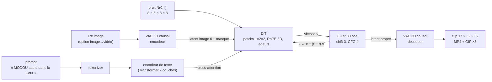

# Mini-moteur vidéo de la troupe

> Recréation **miniature**, entraînée **de zéro sur CPU** et **sans budget**, de la recette des générateurs vidéo
> actuels (Wan 2.x, HunyuanVideo, et Veo 3 / Kling pour ce qui en est public), appliquée à des « marionnettes »
> de la troupe de [@comedyvideos_100](https://www.tiktok.com/@comedyvideos_100).

Tapez `"MODOU saute dans la Cour"` : le moteur part d'un bloc de bruit et, en 30 pas guidés par le texte, fait apparaître
un clip de 17 images où MODOU (t-shirt vert délavé, pantalon cargo marron) saute devant le mur de parpaings de la Cour.
Donnez-lui en plus une première image : il l'anime (image→vidéo, comme Wan I2V ou Kling).

## Soyons honnêtes sur l'échelle

| | mini-moteur | Wan 2.2 (ouvert) | Veo 3 / Kling (fermés) |
|---|---|---|---|
| image | **32×32 px**, 17 images (~2 s à 8 i/s) | 1280×704, 121 images (5 s à 24 i/s) | jusqu'à 1080p, 8 s et plus |
| paramètres | **~8,6 millions** (VAE 1,2 M + texte 0,4 M + DiT 6,9 M) | 5 milliards (TI2V-5B) à 27 milliards (A14B, MoE) + umT5 gelé | non publiés |
| données | ~3 000 clips de marionnettes **dessinés par le programme** | « des milliards d'images et de vidéos » (~1 000 milliards de jetons) | non publiées |
| calcul | **4 cœurs CPU, ~35 min** | des centaines de GPU (budget non publié) | TPU / GPU, non publié |

Recréer un vrai moteur coûte au moins ~200 000 $ (Open-Sora 2.0, borne basse publiée). Ce projet ne produit donc **pas**
de vidéos utilisables sur TikTok : il **prouve la recette de bout en bout**, pièce par pièce, avec un code que vous
possédez et comprenez. L'étape suivante (en bas de page) garde la même architecture et charge les vrais poids de Wan 2.2.

---

## Le pipeline en un schéma

```
 « MODOU saute dans la Cour »
            │ tokenizer (28 mots)
            ▼
 ┌──────────────────────┐   jetons de texte (B, L, 128)
 │ encodeur de texte     │──────────────────────────────┐
 │ Transformer 2 couches │                              │ cross-attention
 └──────────────────────┘                              ▼
                                         ┌───────────────────────────────┐
 bruit N(0, I) ── latent 8×5×8×8 ───────▶│ DiT : 6 blocs, 80 jetons        │
                                         │ patchs 1×2×2 + RoPE 3D          │──▶ vitesse v
 (option I2V) 1re image ─▶ VAE encodeur ─▶│ adaLN(t) + self-attn + cross-attn│      │
              latent image 0 + masque    └───────────────────────────────┘      │
                                                     ▲                           │
                                                     └── 30 pas d'Euler + CFG ◀──┘
                                                                 │ latent propre
                                                                 ▼
                                         VAE décodeur causal ─▶ 17×32×32 ─▶ MP4 256×256 + GIF
```



Analogie (la même que dans les notes de recherche) : le **VAE** est un « zip » qui transforme la vidéo en une petite pâte
de nombres ; le **DiT** est un sculpteur qui part d'un bloc de bruit et, en 30 coups de ciseau guidés par le texte, fait
apparaître la pâte d'une vidéo ; l'**encodeur de texte** traduit le prompt en intentions lisibles par le sculpteur ; la
**CFG** est un curseur « obéir au texte » ; le VAE « dézippe » à la fin.

---

## Les modules

| fichier | rôle |
|---|---|
| [`minimoteur/config.py`](minimoteur/config.py) | toutes les tailles (dataclasses), préréglage `tiny_config()` pour les tests |
| [`minimoteur/troupe_data.py`](minimoteur/troupe_data.py) | jeu de données procédural : 7 marionnettes × 5 actions × 4 décors, légendes, combinaisons tenues à l'écart |
| [`minimoteur/text_encoder.py`](minimoteur/text_encoder.py) | tokenizer par mots + Transformer 2 couches + embedding « nul » appris (CFG) |
| [`minimoteur/vae.py`](minimoteur/vae.py) | VAE vidéo 3D **causal** (`CausalConv3d`), 17×32×32 → 5×8×8×8, normalisation du latent mesurée sur les données |
| [`minimoteur/dit.py`](minimoteur/dit.py) | Transformer de diffusion : patchs 1×2×2, RoPE 3D, adaLN-Zero, cross-attention, entrée image→vidéo (latent + masque) |
| [`minimoteur/flow.py`](minimoteur/flow.py) | flow matching (vitesse `v = bruit − x0`), `t` logit-normal, shift, Euler, CFG — conventions de signe expliquées |
| [`minimoteur/pipeline.py`](minimoteur/pipeline.py) | chargement des checkpoints, génération texte→vidéo / image→vidéo |
| [`minimoteur/train.py`](minimoteur/train.py) | CLI d'entraînement : `vae` puis `dit` (T2V/I2V mélangés 50/50, texte effacé 10 %, EMA) |
| [`minimoteur/generate.py`](minimoteur/generate.py) | CLI de génération → MP4 H.264 (yuv420p) 256×256 + GIF |
| [`minimoteur/evaluate.py`](minimoteur/evaluate.py) | mesures automatiques (PSNR, identité, action, décor, fluidité, I2V) → JSON + Markdown |
| [`minimoteur/video_io.py`](minimoteur/video_io.py) | écriture MP4 (ffmpeg) / GIF / PNG, planches |
| [`tests/`](tests/) | 37 tests pytest (< 15 s) : causalité du VAE, RoPE, flow, Euler, CFG, sur-apprentissage, données… |

### Les marionnettes (tirées de [`troupe.json`](../troupe/troupe.json), personnages « planche »)

| personnage | palette (d'après le champ « visuel ») | taille (`taille_m` → px sur 32) |
|---|---|---|
| MAMAN NOUNOU | robe rouge à pois jaunes, foulard rouge, tablier vichy vert et blanc, ronde | 1,60 m → 18,4 px |
| BAYE NDIAYE | boubou bleu roi à col doré, cheveux et barbe gris, rond | 1,72 m → 19,8 px |
| COUMBA | longue robe rose rayée de violet, longues tresses noires | 1,70 m → 19,6 px |
| PETIT MAMADOU | maillot jaune à col vert, short bleu, petit | 1,15 m → 13,2 px |
| MODOU | t-shirt vert délavé, pantalon cargo marron, mince | 1,76 m → 20,2 px |
| TANTIE AWA | robe orange à pois jaunes, foulard orange, ronde | 1,62 m → 18,6 px |
| KOFFI | blazer bordeaux à damier doré sur chemise noire, chaîne en or, lunettes noires, pantalon noir | 1,78 m → 20,5 px |

Toutes les têtes ont une peau brune. Le blazer de KOFFI est décrit « patterned » sans couleur : le bordeaux à damier or
est un choix du mini-moteur. Si la bible change, `load_troupe()` avertit quand un mot-clé du costume disparaît du visuel.

- **Actions** : `saute`, `marche vers la droite`, `marche vers la gauche`, `parle` (bouche, geste du bras, tête qui
  bouge), `tombe` (bascule jusqu'à être allongé).
- **Décors** : `au Marché` (parasols rayés, étals de tomates), `dans le Salon` (murs bleu-vert, cadre, horloge, canapé),
  `dans la Cour` (tôle ondulée, parpaings, rideau jaune), `au Maquis` (nuit, guirlande, ardoise, télé, tables bleues).
- **Légende** : `{NOM} {action} {au Marché | dans le Salon | dans la Cour | au Maquis}`.
- **Combinaisons jamais vues à l'entraînement** (20 sur 140, ~14 %) : règle fixe
  `(i_personnage + 2·i_action + 3·i_décor) mod 7 = 0`. Chaque paire (personnage, action), (personnage, décor) et
  (action, décor) reste vue : le modèle doit **recombiner** des éléments connus (généralisation compositionnelle).

<details>
<summary>Les 20 prompts tenus à l'écart</summary>

MAMAN NOUNOU saute au Marché · MAMAN NOUNOU marche vers la gauche dans le Salon · MAMAN NOUNOU tombe dans la Cour ·
BAYE NDIAYE saute dans la Cour · BAYE NDIAYE marche vers la gauche au Maquis · BAYE NDIAYE parle au Marché ·
COUMBA marche vers la droite dans le Salon · COUMBA parle dans la Cour · PETIT MAMADOU marche vers la droite au Maquis ·
PETIT MAMADOU marche vers la gauche au Marché · PETIT MAMADOU tombe dans le Salon · MODOU saute dans le Salon ·
MODOU marche vers la gauche dans la Cour · MODOU tombe au Maquis · TANTIE AWA saute au Maquis ·
TANTIE AWA marche vers la droite au Marché · TANTIE AWA parle dans le Salon · KOFFI marche vers la droite dans la Cour ·
KOFFI parle au Maquis · KOFFI tombe au Marché
</details>

---

## Correspondance module par module : mini-moteur ↔ Wan 2.2 ↔ Veo 3

Sources : [notes de recherche « technologie du moteur vidéo »](<../../research_notes/Moteurs vidéo IA pour la troupe/technologie_moteur_video.md>)
(rapports techniques Wan 2.1, fichiers de configuration Wan 2.2, rapport technique Veo 3). « Non publié » = Google n'a
pas donné le détail.

| étage | mini-moteur | Wan 2.2 | Veo 3 (public) |
|---|---|---|---|
| **Données** | ~3 000 clips procéduraux, légendes à gabarit, 20 combinaisons tenues à l'écart | milliards d'images et de vidéos (~1T jetons), filtrage (OCR, esthétique, flou, mouvement…), légendes denses par un VLM maison ; Wan 2.2 : +65,6 % d'images, +83,2 % de vidéos vs 2.1 | légendes à plusieurs niveaux de détail par plusieurs modèles Gemini, filtrage sécurité/qualité, déduplication ; volumes non publiés |
| **Encodeur de texte** | Transformer 2 couches (0,4 M), **entraîné avec le DiT**, vocabulaire fermé de 28 mots | **umT5-XXL gelé** (multilingue, 512 jetons, > 20 Go GPU) | non publié |
| **VAE vidéo** | 3D **causal**, 4× temps, 4×4 espace, **8 canaux**, 1,2 M paramètres, L1 + MSE + KL (β = 1e-4), RMSNorm | 3D causal ; TI2V-5B : **4×16×16, 48 canaux** ; A14B : VAE 2.1 (4×8×8, 16 canaux, 127 M, L1 + KL + LPIPS + GAN) | « autoencodeurs » vidéo et audio séparés ; détails non publiés |
| **Débruiteur** | **DiT** 6 blocs, dim 256, 4 têtes, 6,9 M | **DiT** TI2V-5B : 30 couches, dim 3072, 24 têtes ; A14B : 2 experts de ~14 B (bruit fort / bruit faible) | « transformer-based denoising network » |
| **Jetons** | patchs 1×2×2 → **80 jetons** | patchs 1×2×2 → ~27 000 (TI2V-5B, 720p 121 images) à ~75 000 (2.1, 720p) | non publié |
| **Positions** | RoPE 3D (dimension de tête répartie t / h / w comme Wan) | RoPE 3D | non publié |
| **Pas de temps** | adaLN partagé + table par bloc, gates et tête à zéro (adaLN-Zero) | adaLN partagé (MLP unique → 6 vecteurs) + table par bloc | non publié |
| **Texte → vidéo** | cross-attention dans chaque bloc | cross-attention dans chaque bloc | non publié |
| **Image → vidéo** | latent de l'image 0 (+ zéros) + **masque 1 canal**, concaténés au latent bruité ; un seul modèle T2V+I2V | latent image + masque (4 canaux) concaténés ; Wan 2.1 I2V ajoute CLIP ViT-H par cross-attention ; TI2V-5B unifie T2V et I2V | image→vidéo proposé ; mécanisme non publié |
| **Objectif** | flow matching, vitesse `v = bruit − x0`, `t` logit-normal | flow matching, vitesse, `t` logit-normal | « latent diffusion » (objectif exact non publié) |
| **Échantillonnage** | Euler 30 pas, shift 3, CFG 4 | 50 pas, shift 5, CFG 5 (TI2V-5B) | non publié |
| **CFG** | embedding « nul » appris, texte effacé 10 % du temps | prompt négatif par défaut (texte « vide » / négatif) | non publié |
| **Audio** | aucun | modèles séparés (Wan-S2V, audio → vidéo) | **audio et vidéo générés ensemble** (diffusion conjointe des deux latents) |
| **Accélération** | aucune (EMA des poids seulement) | communauté : distillation 4-8 pas (LightX2V), cache, quantification GGUF/FP8 | non publié |
| **Matériel** | CPU 4 cœurs, ~35 min | centaines de GPU (exemple publié : 128 GPU) | non publié |

Ce que le mini-moteur **ne** reproduit **pas** : la super-résolution en cascade, l'audio, le post-entraînement
(SFT, préférences/DPO), la réécriture de prompt par un LLM, la distillation, les références multiples de personnage.

---

## Utilisation

Prérequis : Python ≥ 3.10, `torch` (version CPU suffit), `numpy`, `pillow`, `ffmpeg` dans le PATH (et `pytest` pour les
tests). Depuis ce dossier (`studio-troupe/mini-moteur`) :

```bash
# (une fois) environnement
python -m venv .venv && . .venv/bin/activate
pip install torch --index-url https://download.pytorch.org/whl/cpu
pip install numpy pillow pytest

# 1) tests (< 15 s)
python -m pytest -q tests

# 2) entraîner le VAE vidéo (~9 min sur 4 cœurs) -> runs/vae.pt
python -m minimoteur.train vae

# 3) entraîner le DiT + l'encodeur de texte, VAE gelé (~23 min) -> runs/dit.pt
python -m minimoteur.train dit

# 4) générer : texte -> vidéo (MP4 256x256 + GIF)
python -m minimoteur.generate --prompt "MODOU saute dans la Cour" --steps 30 --cfg 4 --shift 3 --seed 0 --out clip.mp4

# 4b) image -> vidéo avec votre image (redimensionnée en 32x32)
python -m minimoteur.generate --prompt "MODOU saute dans la Cour" --image premiere_image.png --out clip_i2v.mp4

# 4c) image -> vidéo avec une 1re image dessinée par le moteur de rendu des marionnettes
python -m minimoteur.generate --prompt "KOFFI parle au Maquis" --image-from "KOFFI parle au Maquis" --out koffi.mp4

# 5) mesures automatiques -> runs/eval.json, runs/eval.md, runs/eval_planche.png (~1 min)
python -m minimoteur.evaluate
```

Options utiles : `--steps`, `--batch`, `--n-clips`, `--lr` (entraînement) ; `--hidden`, `--depth`, `--heads` (taille du
DiT) ; `--tiny` (version minuscule pour vérifier que tout s'enchaîne en quelques secondes) ; `--no-ema`, `--fps`,
`--scale` (génération). `python -m minimoteur.train --help`, `python -m minimoteur.generate --help`.

Les checkpoints, journaux (`runs/*_log.jsonl`, une ligne JSON par mesure) et le cache des clips/latents vont dans
`runs/` (ignoré par git). Le checkpoint `dit.pt` contient aussi le VAE et le vocabulaire : il se suffit à lui-même.

---

## Résultats mesurés

> **À remplir après entraînement** (phase suivante : `train vae`, `train dit`, puis `evaluate`).

| mesure | tenus à l'écart | vus | vrais clips (plafond du détecteur) |
|---|---|---|---|
| PSNR du VAE (dB) | _à remplir_ | — | — |
| texte→vidéo : identité / action / décor | _à remplir_ | _à remplir_ | 100 % / 100 % / 100 % |
| texte→vidéo : saccade du centre (px/image²) | _à remplir_ | _à remplir_ | ~0,64 / ~0,74 |
| image→vidéo : PSNR image 0 (dB), persistance de l'identité | _à remplir_ | _à remplir_ | — |

Déjà mesuré pendant la construction (4 cœurs Xeon 2,1 GHz, sans GPU) :

- 37 tests réussis en ~9 s ;
- VAE (1 237 923 paramètres) : **0,34 s par pas** (lot de 8) → 1 600 pas ≈ 9 min ;
- DiT (6 944 032 paramètres) + texte (402 048) : **0,46 s par pas** (lot de 32) → 3 000 pas ≈ 23 min ;
- génération d'un clip (30 pas, CFG) : ~1 s ; rendu des 3 000 clips d'entraînement : ~20 s ;
- les détecteurs de l'évaluation reconnaissent 100 % des vrais clips (identité, action, décor), ce qui rend leurs scores
  interprétables sur les clips générés.

---

## Limites (à connaître avant d'en attendre trop)

- **32×32 pixels, 2 secondes, un seul personnage** : on voit des silhouettes colorées, pas des visages ni des
  expressions. Pas de lip-sync, pas de son, pas de dialogue.
- **Vocabulaire fermé** : 7 personnages, 5 actions, 4 décors, 28 mots. « MODOU danse à la plage » donne `<unk>` pour
  les mots inconnus : l'encodeur de texte n'a jamais lu autre chose que ces légendes (un vrai moteur utilise un umT5 ou
  un LLM pré-entraîné sur des milliards de phrases).
- **Données synthétiques** : le modèle apprend à imiter un dessinateur procédural, pas le monde réel. La
  généralisation testée est **compositionnelle** (nouvelles combinaisons d'éléments connus), pas créative.
- **Détecteurs de l'évaluation faits main** : ils lisent des couleurs et des trajectoires ; ils mesurent « est-ce le bon
  personnage / la bonne action / le bon décor », pas la beauté.
- **Pas de post-entraînement** (SFT, DPO), pas de distillation (30 pas × 2 passes pour la CFG), pas de super-résolution.

---

## Étape suivante : la même architecture avec les vrais poids de Wan 2.2 (gratuit, Kaggle T4)

Chaque pièce du mini-moteur a son équivalent direct dans Wan 2.2 (tableau ci-dessus). Le passage à l'échelle consiste à
**remplacer les pièces par les vraies**, pas à réentraîner :

1. **Encodeur de texte** → umT5-XXL gelé de Wan (même interface : embeddings `(B, L, D)` + masque).
2. **VAE** → Wan2.2-VAE (4×16×16, 48 canaux) ; le `--image` du mini-moteur devient l'image→vidéo de **Wan2.2-TI2V-5B**,
   qui, comme notre DiT, fait texte→vidéo et image→vidéo dans un seul modèle.
3. **DiT + échantillonneur** → poids TI2V-5B, 50 pas (ou 4-8 pas distillés), shift 5, CFG 5.
4. **Matériel** : Kaggle donne ~30 h de GPU T4 (16 Go) par semaine gratuitement ; d'après nos notes de calcul, le choix
   réaliste sur T4 est **Wan 2.2 TI2V-5B en GGUF/fp16 à 480p**, ~9 à 15 min par clip (le T4 n'a pas de FP8 natif) — voir
   [calcul et coûts](<../../research_notes/Moteurs vidéo IA pour la troupe/calcul_et_couts.md>).
5. **Personnages** : au lieu de marionnettes, la vraie troupe passe par une image de référence (I2V) puis, plus tard,
   une LoRA par personnage (affinage, 24 Go de VRAM recommandés).

Ce conteneur (4 CPU, sans GPU) reste l'**orchestrateur** : préparer les prompts, pousser les notebooks Kaggle, rapatrier
les MP4. Le mini-moteur sert de banc d'essai pour comprendre et tester chaque réglage (pas, shift, CFG, I2V) avant de
dépenser des heures de GPU.
