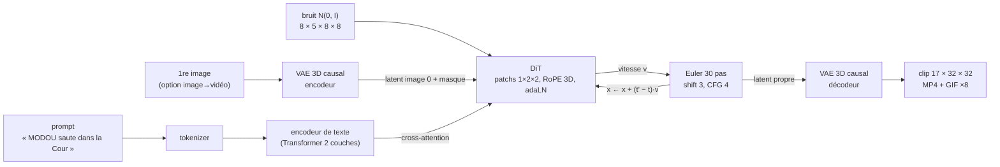

# Mini-moteur vidéo de la troupe

> Recréation **miniature**, entraînée **de zéro sur CPU** et **sans budget**, de la recette des générateurs vidéo
> actuels (Wan 2.x, HunyuanVideo, et Veo 3 / Kling pour ce qui en est public), appliquée à des « marionnettes »
> de la troupe de [@comedyvideos_100](https://www.tiktok.com/@comedyvideos_100).

Tapez `"MODOU saute dans la Cour"` : le moteur part d'un bloc de bruit et, en 30 pas guidés par le texte, **doit** faire
apparaître un clip de 17 images où MODOU (t-shirt vert délavé, pantalon cargo marron) saute devant le mur de parpaings de
la Cour. **Avec le checkpoint livré** (1 500 pas d'entraînement seulement), ce prompt précis donne encore MAMAN NOUNOU qui
« parle » : environ 4 clips texte→vidéo sur 10 seulement ont à la fois le bon personnage, la bonne action et le bon décor
(voir [Résultats mesurés](#résultats-mesurés)). Donnez-lui en plus une première image : il l'anime (image→vidéo, comme
Wan I2V ou Kling), et là 8 clips sur 10 sont justes sur les trois critères (prompts vus).

## Soyons honnêtes sur l'échelle

| | mini-moteur | Wan 2.2 (ouvert) | Veo 3 / Kling (fermés) |
|---|---|---|---|
| image | **32×32 px**, 17 images (~2 s à 8 i/s) | 1280×704, 121 images (5 s à 24 i/s) | jusqu'à 1080p, 8 s et plus |
| paramètres | **~9,1 millions** (VAE 1,8 M + texte 0,4 M + DiT 6,9 M) | 5 milliards (TI2V-5B) à 27 milliards (A14B, MoE) + umT5 gelé | non publiés |
| données | ~3 000 clips de marionnettes **dessinés par le programme** | « des milliards d'images et de vidéos » (~1 000 milliards de jetons) | non publiées |
| calcul | **4 cœurs CPU, ~33 min** d'entraînement | des centaines de GPU (budget non publié) | TPU / GPU, non publié |

Recréer un vrai moteur coûte au moins ~200 000 $ (Open-Sora 2.0, borne basse publiée). Ce projet ne produit donc **pas**
de vidéos utilisables sur TikTok : il **prouve la recette de bout en bout**, pièce par pièce, avec un code que vous
possédez et comprenez. L'étape suivante (en bas de page) passe aux vrais poids de Wan 2.2, lancés avec le code officiel
(ou Diffusers / ComfyUI) : même recette, mais le mini-moteur n'est pas un chargeur de poids Wan (tailles et quelques
mécanismes diffèrent, voir le tableau de correspondance).

---

## Le pipeline en un schéma

```
 « MODOU saute dans la Cour »
            │ tokenizer (28 mots)
            ▼
 ┌──────────────────────┐   jetons de texte (B, L, 128)
 │ encodeur de texte     │──────────────────────────────┐
 │ Transformer 2 couches │                              │ cross-attention
 └──────────────────────┘                              ▼
                                         ┌───────────────────────────────┐
 bruit N(0, I) ── latent 8×5×8×8 ───────▶│ DiT : 6 blocs, 80 jetons        │
                                         │ patchs 1×2×2 + RoPE 3D          │──▶ vitesse v
 (option I2V) 1re image ─▶ VAE encodeur ─▶│ adaLN(t) + self-attn + cross-attn│      │
              latent image 0 + masque    └───────────────────────────────┘      │
                                                     ▲                           │
                                                     └── 30 pas d'Euler + CFG ◀──┘
                                                                 │ latent propre
                                                                 ▼
                                         VAE décodeur causal ─▶ 17×32×32 ─▶ MP4 256×256 + GIF
```



Analogie (la même que dans les notes de recherche) : le **VAE** est un « zip » qui transforme la vidéo en une petite pâte
de nombres ; le **DiT** est un sculpteur qui part d'un bloc de bruit et, en 30 coups de ciseau guidés par le texte, fait
apparaître la pâte d'une vidéo ; l'**encodeur de texte** traduit le prompt en intentions lisibles par le sculpteur ; la
**CFG** est un curseur « obéir au texte » ; le VAE « dézippe » à la fin.

---

## Les modules

| fichier | rôle |
|---|---|
| [`minimoteur/config.py`](minimoteur/config.py) | toutes les tailles (dataclasses), préréglage `tiny_config()` pour les tests |
| [`minimoteur/troupe_data.py`](minimoteur/troupe_data.py) | jeu de données procédural : 7 marionnettes × 5 actions × 4 décors, légendes, combinaisons tenues à l'écart |
| [`minimoteur/text_encoder.py`](minimoteur/text_encoder.py) | tokenizer par mots + Transformer 2 couches + embedding « nul » appris (CFG) |
| [`minimoteur/vae.py`](minimoteur/vae.py) | VAE vidéo 3D **causal** (`CausalConv3d`), 17×32×32 → 5×8×8×8, normalisation du latent mesurée sur les données |
| [`minimoteur/dit.py`](minimoteur/dit.py) | Transformer de diffusion : patchs 1×2×2, RoPE 3D, adaLN (gates et tête à zéro), cross-attention, entrée image→vidéo par concaténation latent + masque (comme Wan I2V-A14B) |
| [`minimoteur/flow.py`](minimoteur/flow.py) | flow matching (vitesse `v = bruit − x0`), `t` logit-normal, shift, Euler, CFG — conventions de signe expliquées |
| [`minimoteur/pipeline.py`](minimoteur/pipeline.py) | chargement des checkpoints, génération texte→vidéo / image→vidéo |
| [`minimoteur/train.py`](minimoteur/train.py) | CLI d'entraînement : `vae` puis `dit` (T2V/I2V mélangés 50/50, texte effacé 10 %, EMA), `--stop-at`, reprise `--init` |
| [`minimoteur/generate.py`](minimoteur/generate.py) | CLI de génération → MP4 H.264 (yuv420p) 256×256 + GIF |
| [`minimoteur/evaluate.py`](minimoteur/evaluate.py) | mesures automatiques (PSNR, identité, action, décor, fluidité, I2V) → JSON + Markdown ; `--balayage` (CFG / shift) |
| [`minimoteur/video_io.py`](minimoteur/video_io.py) | écriture MP4 (ffmpeg) / GIF / PNG, planches |
| [`minimoteur/exemples.py`](minimoteur/exemples.py) | fabrique les clips d'exemple de [`exemples/`](exemples/) (MP4 + planches PNG, comparaison pas / CFG) |
| [`tests/`](tests/) | 53 tests pytest (~15 s) : causalité du VAE, RoPE, flow, Euler, CFG, sur-apprentissage, données, reprise d'entraînement, détecteurs… |

### Les marionnettes (tirées de [`troupe.json`](../troupe/troupe.json), personnages « planche »)

| personnage | palette (d'après le champ « visuel ») | taille (`taille_m` → px sur 32) |
|---|---|---|
| MAMAN NOUNOU | robe rouge à pois jaunes, foulard rouge, tablier vichy vert et blanc, ronde | 1,60 m → 18,4 px |
| BAYE NDIAYE | boubou bleu roi à col doré, cheveux et barbe gris, rond | 1,72 m → 19,8 px |
| COUMBA | longue robe rose rayée de violet, longues tresses noires | 1,70 m → 19,6 px |
| PETIT MAMADOU | maillot jaune à col vert, short bleu, petit | 1,15 m → 13,2 px |
| MODOU | t-shirt vert délavé, pantalon cargo marron, mince | 1,76 m → 20,2 px |
| TANTIE AWA | robe orange à pois jaunes, foulard orange, ronde | 1,62 m → 18,6 px |
| KOFFI | blazer bordeaux à damier doré sur chemise noire, chaîne en or, lunettes noires, pantalon noir | 1,78 m → 20,5 px |

Toutes les têtes ont une peau brune. Le blazer de KOFFI est décrit « patterned » sans couleur : le bordeaux à damier or
est un choix du mini-moteur. Si la bible change, `load_troupe()` avertit quand un mot-clé du costume disparaît du visuel.

- **Actions** : `saute`, `marche vers la droite`, `marche vers la gauche`, `parle` (bouche, geste du bras, tête qui
  bouge), `tombe` (bascule jusqu'à être allongé).
- **Décors** : `au Marché` (parasols rayés, étals de tomates), `dans le Salon` (murs bleu-vert, cadre, horloge, canapé),
  `dans la Cour` (tôle ondulée, parpaings, rideau jaune), `au Maquis` (nuit, guirlande, ardoise, télé, tables bleues).
- **Légende** : `{NOM} {action} {au Marché | dans le Salon | dans la Cour | au Maquis}`.
- **Combinaisons jamais vues à l'entraînement** (20 sur 140, ~14 %) : règle fixe
  `(i_personnage + 2·i_action + 3·i_décor) mod 7 = 0`. Chaque paire (personnage, action), (personnage, décor) et
  (action, décor) reste vue : le modèle doit **recombiner** des éléments connus (généralisation compositionnelle).

<details>
<summary>Les 20 prompts tenus à l'écart</summary>

MAMAN NOUNOU saute au Marché · MAMAN NOUNOU marche vers la gauche dans le Salon · MAMAN NOUNOU tombe dans la Cour ·
BAYE NDIAYE saute dans la Cour · BAYE NDIAYE marche vers la gauche au Maquis · BAYE NDIAYE parle au Marché ·
COUMBA marche vers la droite dans le Salon · COUMBA parle dans la Cour · PETIT MAMADOU marche vers la droite au Maquis ·
PETIT MAMADOU marche vers la gauche au Marché · PETIT MAMADOU tombe dans le Salon · MODOU saute dans le Salon ·
MODOU marche vers la gauche dans la Cour · MODOU tombe au Maquis · TANTIE AWA saute au Maquis ·
TANTIE AWA marche vers la droite au Marché · TANTIE AWA parle dans le Salon · KOFFI marche vers la droite dans la Cour ·
KOFFI parle au Maquis · KOFFI tombe au Marché
</details>

---

## Correspondance module par module : mini-moteur ↔ Wan 2.2 ↔ Veo 3

Sources : [notes de recherche « technologie du moteur vidéo »](<../../research_notes/Moteurs vidéo IA pour la troupe/technologie_moteur_video.md>)
et [« anatomie du code d'un moteur ouvert »](<../../research_notes/Moteurs vidéo IA pour la troupe/anatomie_code_moteur_ouvert.md>)
(rapports techniques Wan 2.1, code et fichiers de configuration Wan 2.2, rapport technique Veo 3). « Non publié » = Google
n'a pas donné le détail.

| étage | mini-moteur | Wan 2.2 | Veo 3 (public) |
|---|---|---|---|
| **Données** | ~3 000 clips procéduraux, légendes à gabarit, 20 combinaisons tenues à l'écart | milliards d'images et de vidéos (~1T jetons), filtrage (OCR, esthétique, flou, mouvement…), légendes denses par un VLM maison ; Wan 2.2 : +65,6 % d'images, +83,2 % de vidéos vs 2.1 | légendes à plusieurs niveaux de détail par plusieurs modèles Gemini, filtrage sécurité/qualité, déduplication ; volumes non publiés |
| **Encodeur de texte** | Transformer 2 couches (0,4 M), **entraîné avec le DiT**, vocabulaire fermé de 28 mots | **umT5-XXL gelé** (multilingue, 512 jetons, > 20 Go GPU) | non publié |
| **VAE vidéo** | 3D **causal**, 4× temps, 4×4 espace, **8 canaux**, 1,8 M paramètres, L1 + MSE + KL (β = 1e-4), GroupNorm image par image (RMSNorm façon Wan en option) | 3D causal ; TI2V-5B : **4×16×16, 48 canaux** ; A14B : VAE 2.1 (4×8×8, 16 canaux, 127 M, L1 + KL + LPIPS + GAN) | « autoencodeurs » vidéo et audio séparés ; détails non publiés |
| **Débruiteur** | **DiT** 6 blocs, dim 256, 4 têtes, 6,9 M | **DiT** TI2V-5B : 30 couches, dim 3072, 24 têtes ; A14B : 2 experts de ~14 B (bruit fort / bruit faible) | « transformer-based denoising network » |
| **Jetons** | patchs 1×2×2 → **80 jetons** | patchs 1×2×2 → ~27 000 (TI2V-5B, 720p 121 images) à ~75 000 (2.1, 720p) | non publié |
| **Positions, attention** | RoPE 3D (dimension de tête répartie t / h / w comme Wan) ; normalisation q/k (RMSNorm) **tête par tête** | RoPE 3D ; normalisation q/k (RMSNorm) **sur toute la dimension**, toutes têtes ensemble | non publié |
| **Pas de temps** | adaLN partagé + table par bloc ; projection de t et tête à zéro (gates nuls au départ, cross-attention sans gate active dès le départ) | adaLN partagé (MLP unique → 6 vecteurs) + table par bloc tirée au hasard ; parmi les poids, seul celui de la tête part de zéro | non publié |
| **Texte → vidéo** | cross-attention dans chaque bloc | cross-attention dans chaque bloc | non publié |
| **Image → vidéo** | **concaténation de canaux** : latent bruité (8) + latent de l'image 0, images latentes suivantes **mises à 0** (8) + **masque 1 canal** = 17 canaux ; un seul modèle T2V + I2V | deux mécanismes. **I2V-A14B** (comme Wan 2.1 I2V, sans CLIP) : concaténation 16 bruités + 4 de masque + 16 de condition = **36 canaux**, la condition étant VAE(image + images noires), donc non nulle après l'image 0. **TI2V-5B** (T2V + I2V dans un seul modèle) : **aucun canal en plus** ; la 1re image latente du bruit est **remplacée** par celle de l'image avant la boucle et après chaque pas, et ses jetons reçoivent **t = 0**. Wan 2.1 I2V ajoute CLIP ViT-H par cross-attention | image→vidéo proposé ; mécanisme non publié |
| **Objectif** | flow matching, vitesse `v = bruit − x0`, `t` logit-normal | flow matching, vitesse, `t` logit-normal | « latent diffusion » (objectif exact non publié) |
| **Échantillonnage** | Euler 30 pas, shift 3, CFG 4 | solveur **UniPC** (multipas, ordre 2) par défaut, Euler possible ; TI2V-5B : 50 pas, shift 5, CFG 5 ; I2V-A14B : 40 pas, shift 5, CFG 3,5 | non publié |
| **CFG** | embedding « nul » appris, texte effacé 10 % du temps | prompt négatif par défaut (texte « vide » / négatif) | non publié |
| **Audio** | aucun | modèles séparés (Wan-S2V, audio → vidéo) | **audio et vidéo générés ensemble** (diffusion conjointe des deux latents) |
| **Accélération** | aucune (EMA des poids seulement) | communauté : distillation 4-8 pas (LightX2V), cache, quantification GGUF/FP8 | non publié |
| **Matériel** | CPU 4 cœurs, ~33 min | centaines de GPU (exemple publié : 128 GPU) | non publié |

Ce que le mini-moteur **ne** reproduit **pas** : la super-résolution en cascade, l'audio, le post-entraînement
(SFT, préférences/DPO), la réécriture de prompt par un LLM, la distillation, les références multiples de personnage.

---

## Utilisation

Prérequis : Python ≥ 3.10, `torch` (version CPU suffit), `numpy`, `pillow`, `ffmpeg` dans le PATH (et `pytest` pour les
tests). Depuis ce dossier (`studio-troupe/mini-moteur`) :

```bash
# (une fois) environnement
python -m venv .venv && . .venv/bin/activate
pip install torch --index-url https://download.pytorch.org/whl/cpu
pip install numpy pillow pytest

# (si la machine fait déjà tourner un autre calcul lourd) moins de fils de calcul pour TOUTES les commandes,
# sinon les fils se marchent dessus et tout devient des dizaines de fois plus lent :
# export MINIMOTEUR_THREADS=2      # ou --threads 2 sur chaque commande

# 1) tests (~15 s ; bien plus si la machine est chargée et MINIMOTEUR_THREADS non réglé)
python -m pytest -q tests

# 2) entraîner le VAE vidéo -> runs/vae.pt (exactement comme le VAE mesuré plus bas : 2 étapes, ~22 min)
python -m minimoteur.train vae --fg-weight 1 --out runs/vae_etape1.pt            # 1 600 pas, lr 1e-3, ~11 min
python -m minimoteur.train vae --init runs/vae_etape1.pt --steps 1500 --lr 5e-4  # reprise, pixels du personnage x4, ~11 min

# 3) entraîner le DiT + l'encodeur de texte, VAE gelé -> runs/dit.pt
#    Le DiT mesuré plus bas = les 1 500 premiers pas d'un calendrier de 3 200 (entraînement interrompu, voir
#    « Ce qui s'est passé ») ; --stop-at s'arrête là sans changer le calendrier (~10 min) :
python -m minimoteur.train dit --steps 3200 --lr 5e-4 --stop-at 1500
#    Calendrier complet, jamais mesuré ici (3 200 pas, lr 5e-4 : les valeurs de config.py, ~21 min) :
#    python -m minimoteur.train dit

# 4) générer : texte -> vidéo (MP4 256x256 + GIF ; les .mp4/.gif écrits ici sont ignorés par git)
python -m minimoteur.generate --prompt "MODOU saute dans la Cour" --steps 30 --cfg 4 --shift 3 --seed 0 --out clip.mp4

# 4b) image -> vidéo avec votre image (redimensionnée en 32x32)
python -m minimoteur.generate --prompt "MODOU saute dans la Cour" --image premiere_image.png --out clip_i2v.mp4

# 4c) image -> vidéo avec une 1re image dessinée par le moteur de rendu des marionnettes
python -m minimoteur.generate --prompt "KOFFI parle au Maquis" --image-from "KOFFI parle au Maquis" --out koffi.mp4

# 5) mesures automatiques -> runs/eval.json, runs/eval.md, runs/eval_planche.png (~1 min 30)
python -m minimoteur.evaluate

# 5b) balayage des réglages CFG 2 / 4 / 7 (shift 3) et shift 6 (CFG 4) -> runs/balayage.json + .md (~2 min)
python -m minimoteur.evaluate --balayage

# 6) clips d'exemple -> exemples/ (MP4 + planche PNG par clip, comparaison pas / CFG ; ~15 s)
python -m minimoteur.exemples
```

Options utiles : `--steps`, `--stop-at`, `--batch`, `--n-clips`, `--lr` (entraînement) ; `--init`, `--fg-weight` (VAE) ;
`--init`, `--fp32` (DiT : par défaut le calcul se fait en bfloat16, ~13 % plus rapide sur ce CPU) ; `--hidden`, `--depth`,
`--heads` (taille du DiT) ; `--tiny` (version minuscule pour vérifier que tout s'enchaîne en quelques secondes) ;
`--no-ema`, `--fps`, `--scale` (génération) ; `--threads` (toutes les commandes : 4 par défaut, ou la valeur de
`MINIMOTEUR_THREADS` ; mettez 1 ou 2 si la machine est déjà chargée). `python -m minimoteur.train --help`,
`python -m minimoteur.generate --help`.

Le prompt doit suivre le gabarit appris (« NOM action décor »). La génération le ramène à sa forme exacte avant de le
lire : `"modou saute au marche"` devient « MODOU saute au Marché » (sans cela, « marche » sans accent serait lu comme
le verbe). Un prompt hors gabarit déclenche un avertissement.

Les checkpoints, journaux (`runs/*_log.jsonl`, une ligne JSON par mesure) et le cache des clips/latents vont dans
`runs/` (ignoré par git). Le checkpoint `dit.pt` contient aussi le VAE et le vocabulaire : il se suffit à lui-même. Ceux
produits par cette version du code contiennent en plus l'état de l'optimiseur AdamW (pour `--init`) ; le `dit.pt` mesuré
plus bas, plus ancien, ne l'a pas.

`train dit` ne reprend du checkpoint du VAE que ce qui définit les latents (format des clips, données, VAE) ; le reste
(texte, DiT, flow, entraînement) vient de [`config.py`](minimoteur/config.py).

---

## Résultats mesurés

Mesures du 16/10/2026, sur 4 cœurs Xeon 2,1 GHz (avec AMX), sans GPU. Fichiers bruts : `runs/eval.json`, `runs/eval.md`,
`runs/balayage.json`, `runs/*_log.jsonl` (ignorés par git), [`exemples/exemples.json`](exemples/exemples.json). Tous sont
refaits par les commandes 5, 5b et 6 ci-dessus (évaluation relancée après la correction du détecteur d'identité :
chiffres inchangés).

**En bref.** Le moteur **reconnaît le personnage et le décor** demandés, et **anime une première image** de façon fidèle.
Par contre, en texte→vidéo, il **ne fait la bonne action qu'une fois sur deux au mieux**. Deux des cinq objectifs fixés
avant l'entraînement sont manqués : le PSNR du VAE (de 0,3 dB) et l'action en texte→vidéo (42 % au lieu de 60 %). Le DiT
livré n'a fait que **1 500 pas sur les 3 200 prévus** (voir « Ce qui s'est passé »).

### Objectifs de qualité

| objectif (fixé avant l'entraînement) | mesuré | verdict |
|---|---|---|
| VAE : PSNR sur clips tenus à l'écart ≥ 26 dB | **25,68 dB** (min 20,83 dB, 200 clips) | **manqué** de 0,3 dB |
| texte→vidéo : identité ≥ 80 % | **92 %** (prompts vus) ; 98 % (tenus à l'écart) | atteint |
| texte→vidéo : décor ≥ 90 % | **100 %** (vus) ; 100 % (tenus à l'écart) | atteint |
| texte→vidéo : action ≥ 60 % sur les prompts vus | **42 %** (vus) ; 22 % (tenus à l'écart) | **manqué** |
| image→vidéo : PSNR de l'image 0 ≥ 24 dB | **28,8 dB** (vus) ; 28,4 dB (tenus à l'écart) | atteint |

### Temps d'entraînement et taille

| étape | pas × lot | s / pas | durée | résultat |
|---|---|---|---|---|
| VAE, étape 1 (perte uniforme, lr 1e-3) | 1 600 × 8 | 0,39 | 10,9 min | 24,66 dB |
| VAE, étape 2 (reprise, pixels du personnage ×4, lr 5e-4) | 1 500 × 8 | 0,43 | 11,0 min | **25,68 dB** |
| encodage des 3 000 clips en latents (une fois) | — | — | 0,6 min | latents de moyenne 0,00 et d'écart-type 1,00 |
| DiT + texte (bf16, lr 5e-4, EMA 0,999), **arrêté au pas 1 500 / 3 200** (`--stop-at 1500` le refait) | 1 500 × 32 | 0,40 | 10,1 min | perte de vitesse 0,23 |
| **total** | | | **~33 min** | |

Paramètres : VAE 1 792 819, DiT 6 944 032, encodeur de texte 402 048, soit **9 138 899** au total. Les autres temps
mesurés sont les suivants :

- génération d'un clip (30 pas, CFG 4) : ~0,7 s ;
- évaluation complète (160 clips générés + plafonds) : 1 min 30 ;
- balayage CFG / shift (320 clips) : 2 min 20 (2 fils, CPU partagé) ;
- 53 tests réussis : 15 s avec `MINIMOTEUR_THREADS=2` sur ce CPU partagé ; avec les 4 fils par défaut pendant que
  l'autre calcul tournait, 3 min 51 (`python -m pytest -q tests` tel quel).

### Tableau complet (`python -m minimoteur.evaluate`, 30 pas, CFG 4, shift 3, 2 graines × 20 prompts par groupe)

Les détecteurs vérifient d'abord qu'un personnage est là : une image compte comme « avec personnage » si au moins 20
pixels hors décor tombent sur la palette de la troupe (vrais clips : au moins 53 ; décor vide passé dans le VAE : au plus 7).
Sans personnage sur au moins la moitié des images, l'identité vaut « absent », donc fausse ; une image sans personnage
compte comme une erreur de persistance. Dans cette évaluation, tous les clips générés ont un personnage sur toutes
leurs images.

| mesure | prompts | identité | action | décor | les 3 | persistance de l'identité | saccade du centre (px/image²) | PSNR image 0 |
|---|---|---|---|---|---|---|---|---|
| vrais clips (plafond du détecteur) | tenus à l'écart | 100 % | 100 % | 100 % | 100 % | 100 % | 0,73 | — |
| vrais clips (plafond du détecteur) | vus | 100 % | 100 % | 100 % | 100 % | 100 % | 0,69 | — |
| reconstruction par le VAE | tenus à l'écart | 95 % | 82 % | 100 % | 78 % | 92 % | 0,54 | — |
| reconstruction par le VAE | vus | 92 % | 88 % | 100 % | 80 % | 90 % | 0,58 | — |
| **texte→vidéo** | tenus à l'écart | 98 % | 22 % | 100 % | 22 % | 92 % | 0,50 | — |
| **texte→vidéo** | vus | 92 % | 42 % | 100 % | 40 % | 88 % | 0,53 | — |
| **image→vidéo** | tenus à l'écart | 98 % | 70 % | 100 % | 70 % | 92 % | 0,54 | 28,4 dB |
| **image→vidéo** | vus | 100 % | 80 % | 100 % | 80 % | 94 % | 0,55 | 28,8 dB |

Action par action (même évaluation) :

| mode | prompts | saute | marche → droite | marche → gauche | parle | tombe |
|---|---|---|---|---|---|---|
| reconstruction par le VAE | vus | 100 % | 100 % | 100 % | **17 %** | 100 % |
| texte→vidéo | vus | 62 % | 50 % | 38 % | 0 % | 50 % |
| texte→vidéo | tenus à l'écart | 38 % | 25 % | 25 % | 0 % | 25 % |
| image→vidéo | vus | 100 % | 100 % | 88 % | 0 % | 90 % |
| image→vidéo | tenus à l'écart | 88 % | 100 % | 100 % | 0 % | 62 % |

### Ce qui s'est passé, et pourquoi deux objectifs sont manqués

1. **Le DiT a été arrêté au pas 1 500 sur 3 200.** Vers le pas 1 800, un autre calcul lourd a démarré sur la même
   machine : un banc d'essai de Wan 2.1 1,3B sur CPU, lancé en parallèle par une autre tâche. Il a pris la moitié des
   cœurs. Avec deux programmes qui se disputent 4 cœurs, un pas est passé de 0,40 s à **~20 s**, ce qui rendait
   impossible de finir dans le budget. Le checkpoint livré est celui du pas 1 500 (poids EMA). Son taux d'apprentissage
   était encore à 3e-4 : la décroissance cosinus finale n'a pas eu lieu.

   La tendance est bonne. L'action en texte→vidéo (prompts vus) est passée de 25 % (essai à 1 000 pas, ancien VAE) à
   42 % (1 500 pas). La perte, elle, est descendue à 0,19 au pas 1 900, mais ces poids-là n'ont pas été sauvegardés.
2. **« parle » est hors d'atteinte avec ce VAE.** Même les reconstructions des VRAIS clips ne sont reconnues comme
   « parle » que dans 12 à 17 % des cas. La bouche fait 1 pixel et le geste du bras est petit : le VAE (4×4 en espace,
   8 canaux) les efface, et le clip devient « immobile » pour le détecteur.

   Le plafond de l'action en texte→vidéo est donc d'environ 85 %, et non 100 %. Sans « parle », l'action en
   texte→vidéo sur les prompts vus est de 50 %.
3. **Le VAE à 25,7 dB.** 75 % de l'erreur de reconstruction tombait sur le personnage, qui ne couvre que 16 % des
   pixels. La reprise de l'entraînement avec ces pixels pondérés ×4 a fait passer le PSNR de 24,66 à 25,68 dB. Elle a
   surtout fait passer l'identité reconnue après reconstruction de 70-75 % à 92-95 %. Il manque 0,3 dB, faute de temps
   (la courbe montait encore).
4. **L'image→vidéo est bien meilleure que le texte→vidéo** (action 80 % au lieu de 42 %). La première image fixe déjà
   le personnage, sa taille et sa position : le modèle n'a plus qu'à le faire bouger. C'est la même raison qui pousse
   les créateurs à passer par une image de référence avec Kling ou Wan I2V.
5. **Généralisation compositionnelle.** Sur les 20 combinaisons jamais vues, l'identité (98 %) et le décor (100 %) se
   recombinent presque toujours. L'action se transfère moins bien (22 % en texte→vidéo, 70 % en image→vidéo).
6. **Fluidité.** La saccade du centre des clips générés vaut 0,50-0,55 px/image², contre 0,69-0,73 pour les vrais
   clips. Les clips générés ne sont pas saccadés, ils sont plutôt « trop sages » : ils bougent moins que les vrais.
7. **Réglages d'échantillonnage.** Balayage archivé (`python -m minimoteur.evaluate --balayage` → `runs/balayage.json`),
   texte→vidéo, mêmes 2 × 20 prompts et mêmes graines que l'évaluation complète :

   | CFG | shift | identité (vus / tenus à l'écart) | action (vus / tenus à l'écart) | les 3 (vus / tenus à l'écart) |
   |---|---|---|---|---|
   | 2 | 3 | 82 % / 88 % | 48 % / 25 % | 38 % / 20 % |
   | **4** | **3** | **92 % / 98 %** | **42 % / 22 %** | **40 % / 22 %** |
   | 7 | 3 | 98 % / 100 % | 35 % / 20 % | 35 % / 20 % |
   | 4 | 6 | 92 % / 98 % | 45 % / 22 % | 42 % / 22 % |

   Avec 40 clips par case, un pourcentage n'est connu qu'à ±16 points près : les écarts d'action (35 à 48 %) restent
   dans le bruit de la mesure. Seule tendance nette : plus de CFG donne une identité plus sûre (82 → 98 % sur les prompts
   vus) mais pas plus d'action. On garde donc CFG 4 et shift 3.

**Pour atteindre les objectifs** (quand le CPU est libre), il faut d'abord poursuivre le DiT. `--out` garde intact le
checkpoint mesuré :

```bash
python -m minimoteur.train dit --init runs/dit.pt --steps 1700 --lr 3e-4 --out runs/dit_suite.pt   # ~11 min
python -m minimoteur.evaluate --ckpt runs/dit_suite.pt --out-json runs/eval_suite.json --out-md runs/eval_suite.md \
    --sheet runs/eval_suite_planche.png
```

Ce n'est **pas** la suite exacte du calendrier interrompu : le taux d'apprentissage suit un nouveau calendrier court
(montée sur 100 pas, puis cosinus de 3e-4 à 3e-5), et les moments d'AdamW repartent de zéro, car le `dit.pt` livré ne
les contient pas. Par contre, l'EMA continue au pas global (elle n'est pas écrasée), la graine des tirages est décalée de
1 500 (on ne rejoue ni les mêmes lots ni les mêmes bruits) et le checkpoint final indique 3 200 pas. Pour « parle », il
faut un VAE qui garde les petits détails : plus de pas, ou 16 canaux latents comme Wan 2.1.

### Les exemples ([`exemples/`](exemples/), 0,9 Mo)

Les prompts ont été choisis **avant** de voir les résultats, avec la graine 0 et sans aucun tri. Chaque MP4 (256×256,
H.264, 8 i/s) est accompagné d'une planche PNG. La ligne du haut montre le clip de référence dessiné par le moteur de
rendu des marionnettes (pour l'image→vidéo : l'image donnée), la ligne du bas montre le clip généré. Les verdicts des
détecteurs sont écrits à côté.

| fichier | mode | prompt | identité | action (vue) | décor |
|---|---|---|---|---|---|
| `t2v_vu_modou_saute_cour` | T2V, vu | MODOU saute dans la Cour | non (MAMAN NOUNOU) | non (parle) | oui |
| `t2v_vu_coumba_parle_salon` | T2V, vu | COUMBA parle dans le Salon | oui | non (immobile) | oui |
| `t2v_vu_baye_ndiaye_marche_droite_marche` | T2V, vu | BAYE NDIAYE marche vers la droite au Marché | oui | **oui** | oui |
| `t2v_vu_koffi_marche_gauche_salon` | T2V, vu | KOFFI marche vers la gauche dans le Salon | oui | non (parle) | oui |
| `t2v_vu_maman_nounou_tombe_maquis` | T2V, vu | MAMAN NOUNOU tombe au Maquis | non (PETIT MAMADOU) | non (saute) | oui |
| `t2v_tenu_a_l_ecart_tantie_awa_saute_maquis` | T2V, **jamais vu** | TANTIE AWA saute au Maquis | oui | **oui** | oui |
| `t2v_tenu_a_l_ecart_petit_mamadou_marche_droite_maquis` | T2V, **jamais vu** | PETIT MAMADOU marche vers la droite au Maquis | oui | non (saute) | oui |
| `i2v_vu_modou_marche_droite_salon` | I2V, vu | MODOU marche vers la droite dans le Salon | oui | **oui** | oui |
| `i2v_tenu_a_l_ecart_koffi_parle_maquis` | I2V, **jamais vu** | KOFFI parle au Maquis | oui | non (immobile) | oui |

Ce qu'on y voit : le décor est net et toujours juste. Les personnages sont des silhouettes floues aux bonnes couleurs
(boubou bleu de BAYE NDIAYE, robe orange de TANTIE AWA), sans visage. Le mouvement est présent mais souvent mou. En
image→vidéo, la première image est reproduite fidèlement, puis le personnage se brouille au fil des images.

**[`comparaison_pas_cfg.png`](exemples/comparaison_pas_cfg.png)** : « COUMBA saute au Marché » avec le même bruit
initial, en 4, 10 ou 30 pas d'Euler, avec CFG 1 ou 4.

- **Peu de pas = vitesse, sur CE modèle.** 4 pas (0,1 s) donnent presque la même image que 30 pas (0,5 s). Ce n'est
  pas transposable aux vrais moteurs : les poids de base de Wan 2.2 ont besoin de 40 à 50 pas, et les versions en 4-8 pas
  (LightX2V, DMD2, rCM) sont des modèles **distillés à part**, entraînés exprès pour aller vite. Ne lancez pas
  TI2V-5B non distillé en 4 pas.
- **La CFG coûte 2 passes par pas** (60 passes au lieu de 30) et change nettement le résultat : la silhouette devient
  plus contrastée.
- Sur cet exemple tiré au hasard, **aucun réglage ne donne le bon personnage** (le détecteur voit MAMAN NOUNOU) : c'est
  un échec représentatif d'un DiT pas assez entraîné. Les réglages ne remplacent pas l'entraînement.

Pour refaire les exemples : `python -m minimoteur.exemples` (~15 s).

---

## Limites (à connaître avant d'en attendre trop)

- **32×32 pixels, 2 secondes, un seul personnage** : on voit des silhouettes colorées, pas des visages ni des
  expressions. Pas de lip-sync, pas de son, pas de dialogue.
- **Vocabulaire fermé** : 7 personnages, 5 actions, 4 décors, 28 mots. « MODOU danse à la plage » donne `<unk>` pour
  les mots inconnus : l'encodeur de texte n'a jamais lu autre chose que ces légendes (un vrai moteur utilise un umT5 ou
  un LLM pré-entraîné sur des milliards de phrases).
- **Données synthétiques** : le modèle apprend à imiter un dessinateur procédural, pas le monde réel. La
  généralisation testée est **compositionnelle** (nouvelles combinaisons d'éléments connus), pas créative.
- **Détecteurs de l'évaluation faits main** : ils lisent des couleurs et des trajectoires ; ils mesurent « est-ce le bon
  personnage / la bonne action / le bon décor », pas la beauté. Un clip sans personnage est compté « absent » (faux).
- **Pas de post-entraînement** (SFT, DPO), pas de distillation (30 pas × 2 passes pour la CFG), pas de super-résolution.

---

## Étape suivante : la même recette avec les vrais poids de Wan 2.2 (gratuit, Kaggle T4)

Le mini-moteur suit la **même recette** que Wan 2.2 (tableau ci-dessus), mais ce n'est **pas** un chargeur de poids :
les tailles, les noms des couches et quelques mécanismes diffèrent (normalisation q/k, image→vidéo). On ne glisse donc
pas les poids de Wan dans `minimoteur/dit.py` : on les lance avec le code officiel de Wan 2.2, Diffusers ou ComfyUI, et
le mini-moteur sert à comprendre ce que fait chaque pièce et chaque réglage. Pièce par pièce :

1. **Encodeur de texte** → umT5-XXL gelé de Wan (même rôle : embeddings `(B, L, D)` + masque, lus par cross-attention).
2. **VAE** → Wan2.2-VAE (4×16×16, 48 canaux) pour TI2V-5B.
3. **Image→vidéo** → le `--image` du mini-moteur (concaténation latent + masque) correspond à **Wan2.2-I2V-A14B**
   (36 canaux d'entrée, 2 experts de ~14 milliards de paramètres). Le modèle réaliste sur T4, **TI2V-5B**, fait lui aussi
   texte→vidéo et image→vidéo dans un seul modèle, mais **autrement** : il remplace la 1re image latente par celle de
   l'image et lui donne t = 0. Pour l'imiter ici, il faudrait changer la condition : entrée à C canaux, t par jeton dans
   `DiT.forward`, ré-injection de l'image 0 après chaque pas dans `euler_sample`, puis réentraîner.
4. **DiT + échantillonneur** → poids TI2V-5B, UniPC 50 pas, shift 5, CFG 5 (ou 4-8 pas avec une version distillée à
   part, voir plus haut).
5. **Matériel** : Kaggle donne ~30 h de GPU T4 (16 Go) par semaine gratuitement ; d'après nos notes de calcul, le choix
   réaliste sur T4 est **Wan 2.2 TI2V-5B en GGUF/fp16 à 480p**, ~9 à 15 min par clip (le T4 n'a pas de FP8 natif) — voir
   [calcul et coûts](<../../research_notes/Moteurs vidéo IA pour la troupe/calcul_et_couts.md>).
6. **Personnages** : au lieu de marionnettes, la vraie troupe passe par une image de référence (I2V) puis, plus tard,
   une LoRA par personnage (affinage, 24 Go de VRAM recommandés).

Ce conteneur (4 CPU, sans GPU) reste l'**orchestrateur** : préparer les prompts, pousser les notebooks Kaggle, rapatrier
les MP4. Le mini-moteur sert de banc d'essai pour comprendre et tester chaque réglage (pas, shift, CFG, I2V) avant de
dépenser des heures de GPU.
